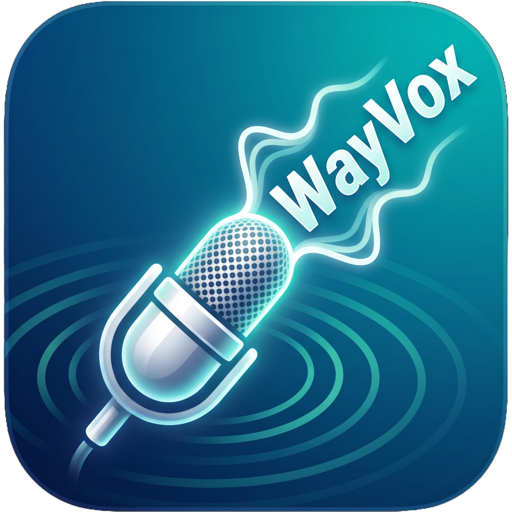

# 🎙️ WayVox



**WayVox** ist eine 100 % lokale, datenschutzkonforme KI-Voice-to-Text Anwendung für Linux (**Wayland / CachyOS / Arch Linux / KDE Plasma 6**). Sie verwandelt gesprochene Sprache über das KI-Modell `faster-whisper` (`large-v3`) in geschriebenen Text und fügt ihn direkt in deine aktive Anwendung ein.

---

## ✨ Features

- 🔒 **100 % Lokal & Offline**: Keine Cloud-Abhängigkeit, volle Kontrolle über deine Daten.
- ⚡ **CUDA 12 GPU-Beschleunigung**: Optimiert für NVIDIA Grafikkarten (z. B. RTX 5070 Ti) mit automatischem CPU-Fallback.
- 🎨 **Modernes Glassmorphic UI**: Transparentes Overlay-Fenster mit interaktivem Vektor-Mikrofonsymbol und dynamischen Status-Animationen (*Bereit*, *Aufnahme*, *Verarbeitung*, *Eingefügt*).
- 🖐️ **Natives Wayland Drag & Drop**: Das Fenster lässt sich per Mausklick frei über den gesamten Desktop und mehrere Monitore verschieben (`startSystemMove`).
- ⌨️ **Anpassbarer Globaler Hotkey**: Flexibler Hotkey (Standard: `F12`) zur Steuerung der Aufnahme ohne Fokusverlust. Über das Kontextmenü lässt sich die Tastenkombination zur Laufzeit beliebig anpassen (alle F-Tasten `F1`–`F12`, `Strg+M`, `Strg+^`, `Strg+<`).
- 🇩🇪 **Perfekte QWERTZ & Umlaut-Unterstützung**: Vollständige Erhaltung deutscher Umlaute (`ä`, `ö`, `ü`, `ß`) und Sonderzeichen ohne Zeichenvertauschung (`z`/`y`).
- 🔊 **Akustisches Feedback**: Dezente Signaltöne beim Starten, Stoppen und erfolgreichen Einfügen des Textes.
- ⚙️ **Flexible Injektionsmethoden**: Unterstützt Kernel-level Injektion via `ydotool type` sowie universelles Zwischenablage-Pasting (Qt / `wl-copy`).

---

## 🛠️ Systemvoraussetzungen & Installation

### 1. Systempakete installieren (Arch Linux / CachyOS)

Installiere die benötigten Systemwerkzeuge, PortAudio und CUDA-Treiber:

```bash
sudo pacman -Syu --needed base-devel python python-pip portaudio wtype ydotool wl-clipboard cuda cudnn
```

### 2. Benutzerrechte & `ydotool` Service einrichten

Füge deinen Benutzer zur Gruppe `input` hinzu (für globale Tastenerkennung) und aktiviere den `ydotool`-Benutzerdaemon:

```bash
# Benutzer zur input-Gruppe hinzufügen
sudo usermod -aG input $USER

# ydotool User Daemon aktivieren
systemctl --user enable --now ydotool
```

> ⚠️ **Hinweis zu `input`-Rechten**: Nach `sudo usermod -aG input $USER` ist einmalig ein Abmelden/Anmelden erforderlich, damit die Gruppenrechte wirksam werden.

### 3. Repository klonen & Virtual Environment einrichten

```bash
git clone https://github.com/PixelPirateEU/WayVox.git
cd WayVox

# Virtual Environment erstellen
python3 -m venv venv

# Abhängigkeiten & CUDA-Bibliotheken (libcublas.so.12) installieren
./venv/bin/pip install -r requirements.txt
```

---

## 🚀 Anwendung starten

Starte die Anwendung einfach über das mitgelieferte Startskript:

```bash
./run.sh
```

*(Das Skript ist vollständig kompatibel mit **Fish Shell**, **Bash** und **Zsh** und nutzt automatisch die vorbereitete Python-Umgebung).*

---

## 🎯 Bedienung

1. **Aufnahme starten/stoppen**: 
   - Drücke deinen eingestellten Hotkey (Standard: **`F12`**) auf der Tastatur (empfohlen, da der Fensterfokus in deiner Zielanwendung bleibt).
   - Alternativ klicke mit der linken Maustaste auf den kreisförmigen Overlay-Button.
2. **Fenster verschieben**: 
   - Halte die linke Maustaste auf dem Overlay gedrückt und ziehe es an eine beliebige Stelle auf deinem Bildschirm.
3. **Kontextmenü & Hotkey anpassen**: 
   - Mache einen **Rechtsklick** auf das Overlay-Icon, um das Kontextmenü zu öffnen:
     - ⚙️ **Hotkey anpassen**: Öffnet ein Fenster mit einem Drop-Down-Menü zur Auswahl deines gewünschten Hotkeys (alle F-Tasten `F1`–`F12`, `Strg+M`, `Strg+^`, `Strg+<`). Der gewählte Hotkey wird sofort im laufenden Betrieb aktiviert und gespeichert.
     - 🔄 **Reset status**: Setzt den visuellen Status des Overlays zurück auf *Bereit*.
     - ❌ **Beenden**: Beendet WayVox sauber.

---

## ⚙️ Konfiguration (`config.json`)

Die Einstellungen werden in `config.json` verwaltet und bei Änderungen über das GUI-Menü automatisch aktualisiert:

```json
{
  "model": {
    "name": "large-v3",
    "device": "cuda",
    "compute_type": "float16",
    "language": "de",
    "beam_size": 5,
    "initial_prompt": "Das ist ein deutscher Text in hoher Qualität."
  },
  "audio": {
    "sample_rate": 16000,
    "channels": 1,
    "device_index": null,
    "feedback_sounds": true,
    "feedback_volume": 0.4
  },
  "injection": {
    "method": "ydotool",
    "paste_delay_ms": 50,
    "fallback_to_clipboard": true
  },
  "hotkey": {
    "enabled": true,
    "combination": "KEY_F12",
    "device_path": null
  },
  "ui": {
    "size": 120,
    "border_width": 6,
    "position_x": 100,
    "position_y": 100,
    "always_on_top": true,
    "show_label": true
  }
}
```

---

## 📜 Lizenz & Credits

Entwickelt für Linux Wayland / CachyOS. Nutzt Open-Source-Komponenten wie `faster-whisper`, `PySide6`, `sounddevice`, `evdev` und `ydotool`.
